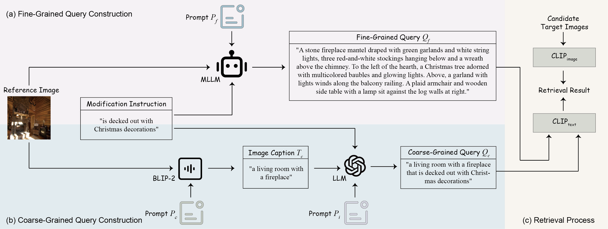

# Dual-Granularity Query Modeling for Zero-Shot Composed Image Retrieval

Submitted to WWW



## Environment
``` shell
conda create -n env_zscir -y python=3.10
source activate env_zscir
pip install torch==2.1.2 torchvision==0.16.2
pip install transformers==4.28.1
pip install tqdm termcolor
pip install pandas==1.4.2
pip install openai==1.107.2
pip install timm==0.9.16
pip install salesforce-lavis==1.0.2
pip install open-clip-torch==2.24.0
pip install numpy==1.24.4
```

## Preprocess
### BLIP-based image caption generation 
```shell
bash preprocess/FashionIQ_BLIP/run_fashioniq_blip.sh
```
### LLM-based coarse-grained query generation
```shell
bash preprocess/FashionIQ/run_fashioniq_query.sh
```

## Inference and MLLM-based fine-grained query generation
```shell
bash run_exp.sh
```
